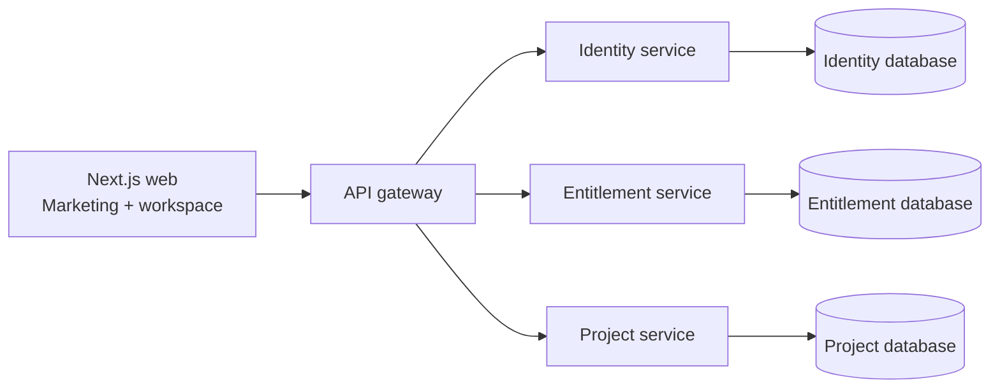

# Architecture overview

AgentFactory OS is organized as two autonomous codebases inside one repository. `frontend` is one Next.js application containing public marketing and protected workspace route groups. `backend` contains four independently deployable Express services, API contracts, and database infrastructure. The gateway is the browser-facing policy boundary. Domain services own their data and expose contracts; they do not share tables.

REST owns session-style commands, health and future webhooks. GraphQL aggregates application data for the workspace. Synchronous HTTP is sufficient until a real asynchronous workflow exists.

Neither codebase imports source files from the other. The frontend consumes the backend only through versioned HTTP contracts, allowing separate installation, CI, deployment, and release lifecycles. Route groups keep marketing and workspace concerns modular without paying the operational cost of microfrontends.
